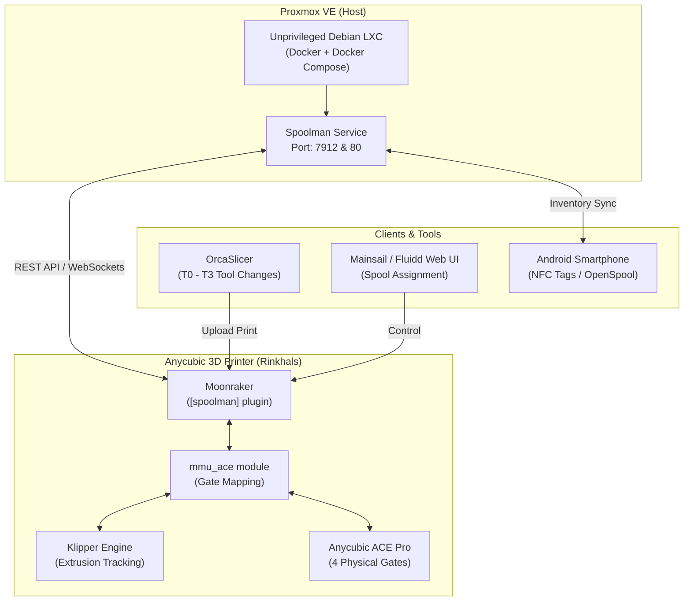

# Spoolman & Anycubic ACE Pro Integration with Rinkhals (Klipper/Moonraker)

A comprehensive guide for hosting **Spoolman** in an unprivileged **Proxmox VE LXC container** and integrating it seamlessly with an **Anycubic Kobra series printer** running **Rinkhals** firmware and the **Anycubic ACE Pro** multi-material system (MMU), including OrcaSlicer workflows and Android NFC tagging.

---

## Architecture Overview



---

## 1. Deploying Spoolman

Spoolman can be deployed either inside an unprivileged **Proxmox VE LXC container** or on any standard **Docker host** (Linux server, Raspberry Pi, NAS, etc.).

---

### Option A: Proxmox VE (Unprivileged LXC Container)

Instead of running Docker directly on the bare Proxmox host, Spoolman runs cleanly inside an isolated, unprivileged Debian LXC container with Docker nesting enabled.

#### 1.1 Create the LXC Container

Run the following commands on your Proxmox VE host (replace placeholders as needed):

```bash
# Variables
VMID=140
HOSTNAME="spoolman"
STORAGE="local-lvm"
BRIDGE="vmbr0"
DISK_SIZE="4G"
MEMORY=1024
CORES=1
TEMPLATE="local:vztmpl/debian-13-standard_13.1-2_amd64.tar.zst"

# 1. Create unprivileged LXC container with Docker nesting support
pct create $VMID $TEMPLATE \
  --hostname $HOSTNAME \
  --storage $STORAGE \
  --rootfs $STORAGE:$DISK_SIZE \
  --memory $MEMORY \
  --cores $CORES \
  --swap 512 \
  --net0 name=eth0,bridge=$BRIDGE,ip=dhcp \
  --onboot 1 \
  --unprivileged 1 \
  --features nesting=1,keyctl=1 \
  --description "Spoolman Filament Inventory Manager"

# 2. Start container
pct start $VMID
```

> [!NOTE]
> Ensure `nesting=1,keyctl=1` is enabled on the unprivileged container; this is required for Docker containers to run properly inside Proxmox LXC.

#### 1.2 Install Docker & Docker Compose inside LXC

Connect to the container via SSH or `pct exec`:

```bash
pct exec 140 -- bash
```

Run the package setup:

```bash
export DEBIAN_FRONTEND=noninteractive
apt-get update && apt-get install -y docker.io docker-compose curl
systemctl enable --now docker
```

#### 1.3 Deploy Spoolman with Docker Compose

Create a directory for Spoolman data and configure `docker-compose.yml`:

```bash
mkdir -p /opt/spoolman/data
chown -R 1000:1000 /opt/spoolman/data
chmod 775 /opt/spoolman/data
```

Create `/opt/spoolman/docker-compose.yml`:

```yaml
services:
  spoolman:
    image: ghcr.io/donkie/spoolman:latest
    container_name: spoolman
    restart: unless-stopped
    volumes:
      - /opt/spoolman/data:/home/app/.local/share/spoolman
    ports:
      - "7912:8000"
      - "80:8000"
    environment:
      - TZ=Europe/Berlin
```

Start the service:

```bash
cd /opt/spoolman
docker-compose up -d
```

---

### Option B: Standalone Docker Host (Linux Server, Raspberry Pi, NAS)

If you already have a host running Docker, you can install Spoolman without Proxmox:

#### Method 1: Docker Compose (Recommended)

1. Create a project directory:
   ```bash
   mkdir -p spoolman/data
   cd spoolman
   ```

2. Create `docker-compose.yml`:
   ```yaml
   services:
     spoolman:
       image: ghcr.io/donkie/spoolman:latest
       container_name: spoolman
       restart: unless-stopped
       volumes:
         - ./data:/home/app/.local/share/spoolman
       ports:
         - "7912:8000"
       environment:
         - TZ=Europe/Berlin
   ```

3. Launch the container:
   ```bash
   docker compose up -d
   ```

#### Method 2: Single `docker run` CLI Command

If you prefer running a single command without Docker Compose:

```bash
mkdir -p ~/spoolman/data

docker run -d \
  --name spoolman \
  --restart unless-stopped \
  -p 7912:8000 \
  -v ~/spoolman/data:/home/app/.local/share/spoolman \
  -e TZ=Europe/Berlin \
  ghcr.io/donkie/spoolman:latest
```

---

### Verification
Verify that Spoolman is running:

```bash
curl -I http://<SPOOLMAN_IP>:7912
```

Access the web interface at `http://<SPOOLMAN_IP>:7912` (or `http://<SPOOLMAN_IP>`).

---

## 2. Printer Configuration (Rinkhals / Moonraker)

In Rinkhals, custom modifications are placed in `.custom.` files to prevent firmware updates from overwriting settings.

### 2.1 Moonraker Setup (`moonraker.custom.conf`)

Add the following block to your `moonraker.custom.conf`:

```ini
[spoolman]
server: http://<SPOOLMAN_IP>:7912
sync_rate: 5

[mmu_ace]
# Optional: Clear spool assignment after a gate is empty for X seconds
# spool_forget_after: 300

# Optional: Auto-matching behavior for RFID spools ('off', 'unique', or 'latest')
# spool_auto_match: unique
```

### 2.2 Klipper Macros (`printer.custom.cfg`)

Add the required Moonraker remote method triggers into `printer.custom.cfg`:

```ini
[gcode_macro SET_SPOOL]
gcode:
    

[gcode_macro CLEAR_ACTIVE_SPOOL]
gcode:
    

[gcode_macro M555]
gcode:
    SET_SPOOL SPOOL_ID={{ params.S }}
```

Restart Moonraker and Klipper (**Restart Moonraker** / **Firmware Restart**).

---

## 3. ACE Pro & Spoolman Workflow

Once configured, Rinkhals natively links each ACE Pro physical slot to Spoolman.

### 3.1 Mapping Spools to Gates in Mainsail / Fluidd
1. Open your printer dashboard (Mainsail or Fluidd).
2. Locate the **MMU / ACE** widget.
3. Open the menu and click **`EDIT FILAMENTS`**.
4. In the dialog, assign the Spoolman Spool ID (e.g. `#1 Sunlu ASA black`) to the corresponding physical Gate (Gate 0–3).
5. Click **Save**. The gate now displays the assigned Spool ID and color.

### 3.2 Dynamic Toolchange Tracking
During printing:
* When Klipper executes `T0` (Gate 0), `mmu_ace` reports the spool bound to Gate 0 as active in Spoolman.
* When a multi-color print switches to `T1` (Gate 1), `mmu_ace` automatically switches the active spool in Spoolman.
* Extrusion lengths are converted to grams based on filament density and deducted from the active spool.

---

## 4. OrcaSlicer Workflow

Because Rinkhals manages the ACE Pro on the printer firmware level, OrcaSlicer does **not** require manual Spool IDs in G-code:

1. **4 Virtual Extruders:** Configure your OrcaSlicer printer profile with 4 filament slots corresponding to the ACE gates:
   * **Slot 1** $\rightarrow$ Gate 0 (`T0`)
   * **Slot 2** $\rightarrow$ Gate 1 (`T1`)
   * **Slot 3** $\rightarrow$ Gate 2 (`T2`)
   * **Slot 4** $\rightarrow$ Gate 3 (`T3`)
2. **Assign Colors:** Match the filament profile colors in OrcaSlicer to what is loaded in the physical gates.
3. **Slice & Print:** Send the job via Moonraker. Rinkhals automatically maps the tool changes to the correct Spoolman database entry.

> [!NOTE]
> The Bambu Lab AMS "Sync" button is proprietary to Bambu hardware. On Klipper-based Anycubic setups, the mapping is managed on the printer's web interface rather than through a slicer sync button.

---

## 5. SpoolmanDB Integration

Spoolman includes native background synchronization with **[SpoolmanDB](https://donkie.github.io/SpoolmanDB/)** (a community database of 9,400+ filaments).

* **Automatic Sync:** Spoolman pulls the database at startup and updates hourly.
* **Adding Spools:** When clicking **+ Add Spool** or **+ Add Filament**, search for the manufacturer (e.g., *Sunlu, Polymaker, eSun, Bambu*). Spoolman automatically pre-fills:
  * Material density (g/cm³)
  * Recommended extruder and bed temperatures
  * Empty spool tare weight
  * Color HEX code

---

## 6. Android NFC Tag Integration

To identify physical spools with your smartphone, attach standard NFC stickers (**NTAG213, NTAG215, or NTAG216**) to your spools.

### Option A: Dedicated Apps (Spoolman GO / SpoolPainter)
1. Install **Spoolman GO** or **SpoolPainter** from the Google Play Store or GitHub.
2. Enter your server URL: `http://<SPOOLMAN_IP>:7912`.
3. Select a spool from your inventory and tap **Write NFC**.
4. Hold the NFC sticker to the back of your phone to write the OpenSpool payload.
5. Tap any tagged spool with your phone to view remaining weight, material, and stats.

### Option B: Generic "NFC Tools" App
* **Web Link:** Use **NFC Tools** to write the direct URL (e.g., `http://<SPOOLMAN_IP>:7912/#/spool/show/<ID>`). Tapping the spool opens its details directly in your browser.
* **Hardware UID:** Scan the tag's factory UID (e.g. `04:A2:3B:5C...`) and paste it into the **Tags** field in Spoolman. Querying `/api/v1/spool?tag=<UID>` will resolve the spool.

---

## License & Attribution

* **Spoolman:** Created by [Donkie](https://github.com/Donkie/Spoolman) (MIT License).
* **Rinkhals:** Maintained by the [Rinkhals Community](https://github.com/rinkhals-community/Rinkhals).
